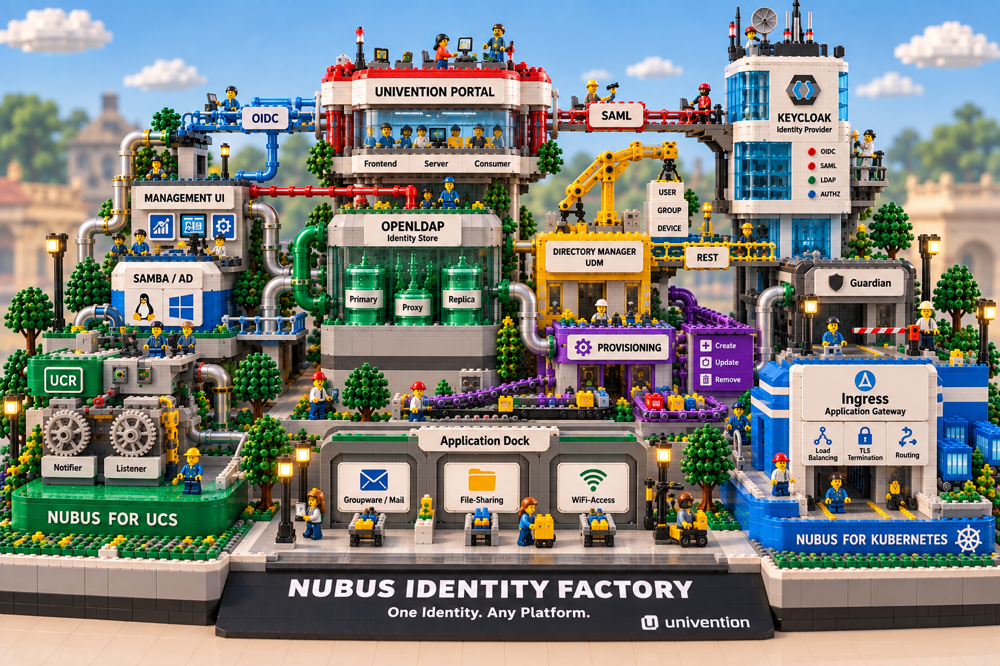
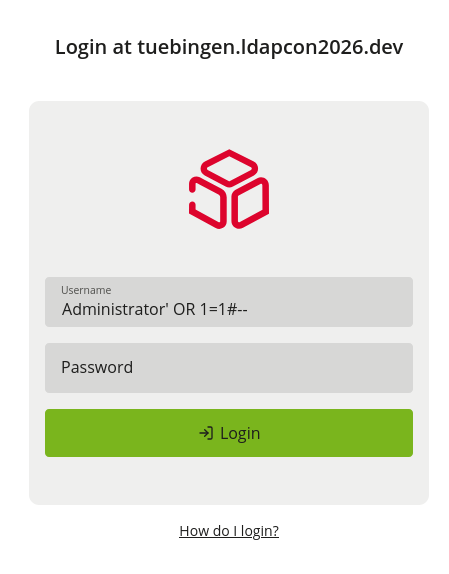
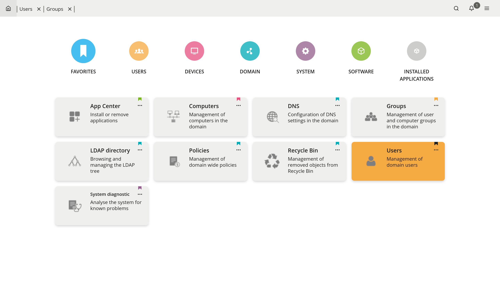
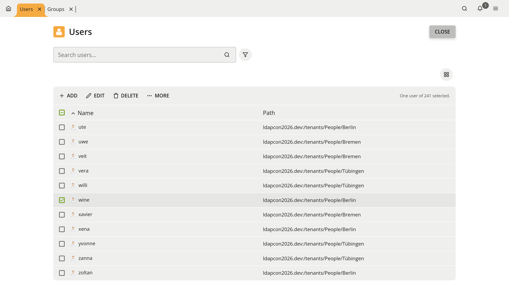
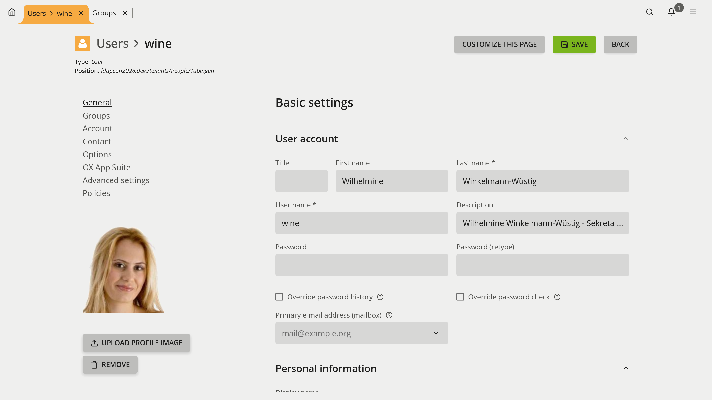
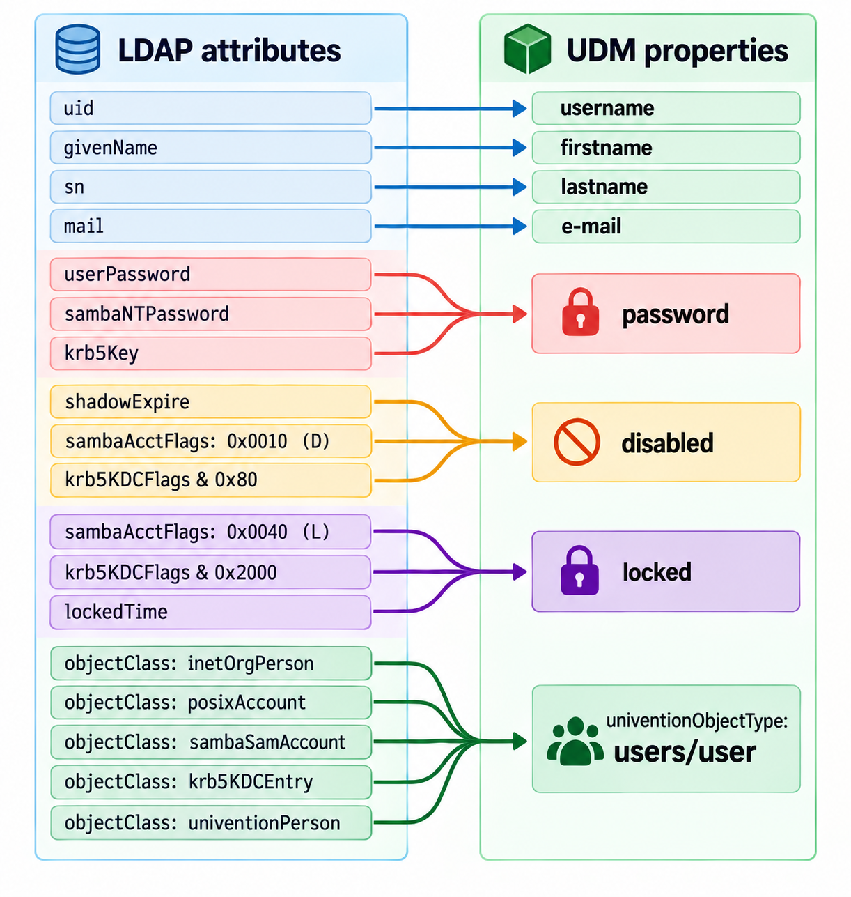
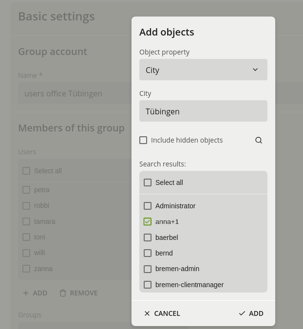
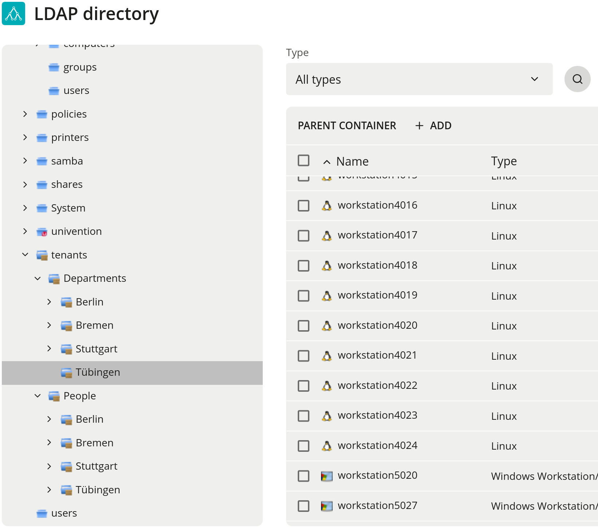

<style>
section {
/*  background-size: 500px;
  background-position: 100% calc(100% + 99px);
  background-repeat: no-repeat;
  background-image: url('images/univention.png');
TODO: add a progress bar to marp slides
*/
  font-size: 14px;
}
.twocol {
  display: grid;
  grid-template-columns: 1fr 1fr;
  gap: 2rem;
}
.red {
    color: #dd042d;
}
.slab-qr .qr {
    display: none;
}
</style>
<style scoped>
  section a {
      font-size: 1.9em;
  }
</style>

<!-- _class: title -->
<!-- _paginate: false -->


# Everything from this talk in one place:

https://spaceone.github.io/ldapcon2026/links.html

---

<!-- _class: title -->
<!-- _paginate: false -->
<!-- _footer: "" -->
<!-- _transition: fade 10s -->


<div class="card">

# Tales from integrating OpenLDAP with the modern world

### How we solve real-world challenges<br> in Univention Nubus using LDAP

<p>
Florian Best  <br>

Univention GmbH  <br>
LDAPCon 2026
<br><br>Everything from this talk in one place:
</p>

---

<!-- _class: zoom-full -->
<!-- _transition: camera-zoom 2.5s -->



---

<!-- _class: zoom-target -->
<!-- _transition: camera-zoom-out 1.5s -->


---

<!-- _class: zoom-out-target -->


## Univention Nubus

<div class="cols">
<div class="card">

### Identity & Access Management

- **Two deployment platforms**
  - **UCS** - on-premises
    - replication via **Univention Directory Listener / Notifier**
  - **Kubernetes / Cloud**
    - replication via **LDAP syncrepl**

- **Extensible with applications**
  - Groupware & Mail - e.g. **Open-Xchange**
  - File Sharing - e.g. **nextCloud**
  - Network Access - e.g. **RADIUS**

- **Modern provisioning stack**
  - event-driven provisioning based on **NATS**

- **Delegated Administration**
  - policy-based authorization with **Guardian**

</div>
<div class="card">

### Identity Services

- **OpenLDAP** as the central directory
- **Keycloak** as Identity Provider & Single Sign-On
  - OpenID Connect & SAML
  - centralized authentication & sessions
  - LDAP identity federation

- **Windows & Active Directory integration**
  - **Samba 4** for Windows domain services
  - **AD-Connector** for synchronization with Microsoft Active Directory
  - **AD-Takeover** for migration from Active Directory

</div>
</div>

---

## OpenLDAP rocks!

<style scoped>
  section div p {
  }
  section .card {
      zoom: 1.6;
  }
</style>

<div class="cols">
<div class="card">

- OpenLDAP has been at the core of Univention and our product since 2002
  - It's been the reliable base for all that time. Thank you!

- LMDB is rock solid!
  - Since it was introduced as the Key-Value store backend,
    we don't have robustness or raw performance problems anymore!

- We are also using Samba 4 Active Directory functionality since 2011
  - Also with LMDB as backend, so that large environments work there, too.

</div>
</div>

---

# Login required!

<!-- _paginate: false -->
<!-- _class: statement -->

> ## `sqli://`? There must be a better way…




---

## crudeoauth - OAuth 2.0 authentication at OpenLDAP

<div class="cols">
<div class="card">

- SASL <a href="https://datatracker.ietf.org/doc/html/rfc">**OAUTHBEARER (RFC 7628)**</a> mechanism
  - authenticate at LDAP server using OAuth 2.0 Access Token
    - e.g. `preferred_username` claim as SASL authentication identity

- usable by any SASL-enabled service (e.g. mail servers)
  - inspired by [crudesaml](https://ftp.espci.fr/pub/crudesaml/) for SAML
  - PAM module available as well

- recently re-written in Rust
  - previous OAuth C library is unmaintained → security concerns
  - Memory management aspects:
    > `C`: remember to `free()`
    > `Rust`: we'd rather not let you double-`free()`
    > `LMDB`: don't `free()` at all, but `mmap()`

- free as in bearer, not as in beer! Check it out:

<div class="slab-qr">
    <span class="slab">
        <a href="https://github.com/univention/crudeoauth">https://github.com/univention/crudeoauth</a>
    </span>
    
</div>

</div>
<div class="card">

#### Mapping of authentication identity:

<div class="code-frame">
<div class="code-title">/etc/ldap/slapd.conf</div>

```dsconfig
authz-regexp
    uid=([a-zA-Z0-9]*),cn=oauthbearer,cn=auth
    ldap:///dc=example,dc=org??sub?(&(objectClass=person)(uid=$1))
```
</div>

#### Configuration options:

<div class="code-frame">
<div class="code-title">/etc/ldap/sasl2/slapd.conf</div>

```yaml
mech_list: … OAUTHBEARER
oauthbearer_userid: preferred_username
oauthbearer_trusted_jwks0: /path/to/authorization_server_certs.jwks
oauthbearer_trusted_iss0: https://sso.example.org/realms/master
oauthbearer_trusted_aud0: ldaps://example.org/
oauthbearer_trusted_azp0: https:/client.example.org/oidc/
oauthbearer_required_scope0: openid
# oauthbearer_disallowed_username0: root
# oauthbearer_allowed_alg0: RS256
# oauthbearer_allowed_alg1: PS256
# oauthbearer_disallowed_alg0: HS256
# oauthbearer_disallowed_alg1: HS384
# oauthbearer_disallowed_alg2: HS512
# oauthbearer_disallowed_alg3: RS512
```

</div>

</div>
</div>

---

<!-- _transition: reveal 2s -->




---
<!-- _transition: reveal 2s -->

<!-- _footer: "" -->




---
<!-- _transition: zoom-image 1.4s -->
<!-- _class: image-fullscreen -->

<style scoped>
  section {
    background-size: 100%;
    background-repeat: no-repeat;
    /*background-image: url('images/udm-user.png');*/
    background-position: center;
  }
  .hero-image {
    width: 100%;
  }
</style>




---

## Univention Directory Manager (UDM)

> make it as easy as possible to administrate the directory

<style scoped>
  section pre {
      margin: 0;
      padding: 1px 3px;
  }
</style>
<div class="cols">
<div class="card">

1. Web user interface - for interactive administration
2. CLI - for scripting and command-line administration
  - ```bash
    udm "users/user" modify --dn "$dn" --set city="Tübingen"
    ```
3. HTTP REST API - for automation & integration


</div>
<div class="card">

- Library written in Python
  - a bit like an **Object Relational Mapper** (ORM) for LDAP
- enriches **LDAP metadata**: human readable labels, descriptions, tooltips, help texts, internationalization
- enforces application-level **consistency**
  - referential integrity
    - non-DN relations, e.g. computer ↔ DNS via `aRecord`
  - locking & uniqueness
  - revert on failure (no LDAP transaction support yet)
  - stricter value sanitization (> DIT content rules)
- **extensible** by apps and customers
  - behavior (schema, hooks, types) for specific use-cases
  - views (widgets, layouting)

</div>
</div>

---

## UDM user objects: LDAP schema made human

<div class="twocol">
<div>



</div>
<div>

- UDM exposes **friendly property names**
  - `username` instead of `uid`
  - `firstname` / `lastname` instead of LDAP schema names

- UDM unifies multiple LDAP object classes into **one object type**:
  e.g. `users/user`

- One UDM object combines several LDAP worlds:
  **LDAP Person**, **POSIX**, **Kerberos**, **Samba/AD**, **Mail**, **Univention extensions**

  - Yes, `inetOrgPerson` has `faxsimileTelephoneNumber` -
    but still no birth date in 2026

- UDM keeps states and password hashes in sync!
  - **multiple LDAP attributes**:
    - `password`, `disabled`, `locked`
    - patched Heimdal + Samba
    - custom OpenLDAP overlay `shadowbind`, `k5pwd`, `pwd_scheme_kinit` + patched `ppolicy`
    - AD/S4-synchronization
</div>
</div>

---

<!-- _class: statement -->
<!-- _transition: fade 1s -->

# Technical Challenges

<p class="note">

> ## `dn1 == dn2` - what could possibly go wrong?

<!-- > ## `"cn=1\2B" == "cn=1\+"` -->
</p>

---

<!-- _footer: "" -->
## Distinguished Names (DN) comparisons

<style scoped>
  section p {
    max-width: 150em;
    word-wrap: no-wrap;
    overflow: hidden;
  }
  section ul {
    gap: var(--space-4);
    margin-bottom: var(--space-4);
  }
  .hide {
    position: absolute;
    left: 100px;
    margin-top: 25px;
  }
  .hide::before {
      content: "→ ";
  }
  section .eyebrow {
    font-size: 1.1em;
  }
</style>

#### Are the following Distinguished Names equal?

<div class="dn-list">

- <code class="dn"><span class="dn-tag rdn1">uid=Dirk T. Tree</span>,<span class="dn-tag rdn2">cn=users</span>,<span class="dn-tag rdn3">ou=Tübingen\\+1</span>,<span class="dn-tag rdn4">dc=freeiam</span>,<span class="dn-tag rdn5">dc=org</span></code>

- <code class="dn"><span class="dn-tag rdn1">UID</span>=Dirk T. Tree,<span class="dn-tag rdn2">CN</span>=users,<span class="dn-tag rdn3">OU</span>=Tübingen\\+1,<span class="dn-tag rdn4">DC</span>=freeiam,<span class="dn-tag rdn5">DC</span>=org</code><span class="hide">case insensitive attribute names</span>
* <code class="dn">UID<span class="dn-ws">  =  </span>Dirk T. Tree<span class="dn-ws"> , </span>CN<span class="dn-ws"> = </span>users<span class="dn-ws"> , </span>OU<span class="dn-ws"> = </span>Tübingen\\+1<span class="dn-ws"> , </span>DC<span class="dn-ws"> = </span>freeiam<span class="dn-ws"> , </span>DC<span class="dn-ws"> = </span>org</code><span class="hide">trailing/leading whitespace (between names, values, separators)</span>
* <code class="dn">UID  =  <span class="dn-tag rdn1">DIRK T. TREE</span> , CN = <span class="dn-tag rdn2">USERS</span> , OU = <span class="dn-tag rdn3">TÜBINGEN\\+1</span> , DC = <span class="dn-tag rdn4">FREEIAM</span> , DC = <span class="dn-tag rdn5">ORG</span></code><span class="hide">if matching rule is case-insensitive</span>
* <code class="dn">UID  =  DIRK T. TREE  ,  CN = <span class="dn-tag rdn2">\55\53\65\52\53</span> , OU = TÜBINGEN<span class="dn-tag rdn3">\2B</span>1 , DC = FREEIAM,DC=ORG</code><span class="hide">hex-escaped values (must: separator chars e.g. `+` for multi-valued RDNs)</span>
* <code class="dn">UID  =  DIRK T. TREE  ,  <span class="dn-tag rdn2">commonName</span> = \55\53\65\52\53  , OU = TÜBINGEN\2B1 , DC = FREEIAM…</code><span class="hide">attribute alias name</span>
* <code class="dn">UID  =  DIRK T. TREE  ,  <span class="dn-tag rdn2">  2.5.4.3 </span> = \55\53\65\52\53  , OU = TÜBINGEN\2B1 , DC = FREEIAM…</code><span class="hide">numeric OID of attribute</span>
* <code class="dn">UID  =  DIRK<span class="dn-space">    </span>T.<span class="dn-space">    </span>TREE ,2.5.4.3 = \55\53\65\52\53  , OU =<s><span class="dn-tag rdn3">"</span>TÜBINGEN<span class="dn-tag rdn3">+</span>1<span class="dn-tag rdn3">"</span></s>, DC = FREEI…</code><span class="hide">multiple consecutive spaces in values can be stripped but quoted values from LDAP V2 are obsolete</span>
* <span class="eyebrow"><u>You cannot reliably normalize a DN without the schema!</u></span> - i.e. on client side. Unlike a URI.
<div class="slab-qr">
    <p class="slab">
    Want to know more?:
        <a href="https://docs.freeiam.org/en/latest/examples/ldap_dn.html">https://docs.freeiam.org/en/latest/examples/ldap_dn.html</a>
    </p>
    
</div>

</div>

---

## User supplied DNs: to compare or not to compare?

<style scoped>
  section code,
  section pre {
      padding: 1px;
      margin: 1em 0em 1em 0;
  }
  section blockquote {
      max-width: 40em;
  }
</style>

<div class="cols">
<div class="card">

#### Example scenarios:
- **Administrator:** types on CLI: Spelling differs when adding/removing group members
- **Samba4-Connector:** Automatic mapping of DNs
  - especially bad for when multiple values are synchronized: The whole operation aborts

#### Two imperfect approaches:

1. Compare in Python: may disagree with OpenLDAP

    ```bash
    $ udm "users/user" modify --dn "$dn" --remove groups="cn = Domain   users , cn = groups , dc = example , dc = org"
    ```
    
    > **WARNING:** cannot remove `"cn = Domain   users , cn = groups , dc = example, dc = org"`
    > from groups, value does not exist

2. Pass through unchanged: may fail in OpenLDAP
    ```bash
    $ udm "users/user" modify --dn "$dn" --append groups="cn = domain   users , dc = example , dc = org" --set city="Tübingen"
    ```
    
    > **LDAP Error: Type or value exists:** value #1 provided more than once
    
    or:
    
    > **LDAP Error: No such attribute:** modify/delete: uniqueMember: no such attribute
</div>
</div>

---

<style scoped>
  section .grid > .item {
      width: 250%;
  }
  .hide {
      visibility: hidden;
  }
/*
git:c3f5b1122f5
git:84089a9d4a9
*/
</style>



<!-- _footer: "" -->
<!-- _paginate: false -->
## Offer possible choices for group memberships in a Web UI

<div class="grid">
<div class="item">

- Group values contains `uniqueMember` from OpenLDAP
- Selection dialog searches `DN` for possible choices:
  - optionally on top: python-ldap-normalized
- <code>uniqueMember: cn=Anna<span class="dn-tag rdn1">\2B1</span></code> vs <code>dn: cn=anna<span class="dn-tag rdn2">+1</span></code>
  - string mismatch on selection
- <u>WORST CASE:</u> → silently dropped group membership on saving

</div>
<div class="item hide">
</div>
<div class="item hide">
</div>
<div class="item">
<span class="badge">2 Problems</span>

- OpenLDAP syntax-normalizes `uniqueMember` values, but does not schema-normalize them:
  - stored DN may differ in case from the actual entry’s DN.
- Python-LDAP normalization differs from OpenLDAP normalization

</div>
</div>

---

## Towards reliable DN comparison

<div class="cols">
<div class="card">

#### Non-Solutions

- ❌️&nbsp;Reimplement schema-based comparison on application level
  - normalization functions for all matching rules - too error prone!
- ❌️&nbsp;Use LDAP `compare()` operation
  - can *only* compare against existing entries
  - need for path traversal of all elements
- ❌️&nbsp;Split modification into multiple LDAP append operations
  - doesn't solve the underlying problem

</div>
<div class="card double-emoji">

#### Pragmatic approach

- Expose `libldap` normalization
  in `python-ldap`:
  - `dn2str(dn, flags=…)`
    `flags=LDAP_DN_FORMAT_LDAPV3`
  - normalizes only syntax!
    - not schema / aliases / syntax / matching-rules
- 🥳 Finally in `python-ldap 3.5.0`
  - <a href="https://github.com/python-ldap/python-ldap/issues/257">Issue #257</a> requested 2019-01-18
  - <a href="https://github.com/python-ldap/python-ldap/pull/466">PR !466</a> provided 2022-04-01
  - merged to main: 2025-08-07
  - release date: 2026-10-??
  - in Debian stable: 2029-??-?? 🤡
</div>
<div class="card">

<span class="badge">A Solution</span>

OpenLDAP could provide:

### Extended operation for LDAP DN comparison

- implemented as an overlay
- `compare_dn(dn_a, dn_b)`
- `dn_intersection(l_dn_a, l_dn_b)`
- doesn't scale for all use-cases
  - lazy local comparison first
- **To Be Implemented!**

</div>
</div>

---

<!-- _class: statement -->
<!-- _transition: fade 1s -->

# Recycle Bin

<p class="note">

> ## `ldapdelete`… now undo it.

</p>

---

## Recycle Bin: Implementable with built-in OpenLDAP features?

<div class="cols">
<div class="card">

#### Humans make mistakes - and need to restore deleted objects

- **Preserve deleted objects in a inactive form**
  - strip the original object classes; store as `objectClass: extensibleObject`
    - prevents authentication and normal object-class-based searches
  - use UUID as RDN (`univentionObjectIdentifier=43026e47-f1e8-4e85-…`)
    - stable and easy to handle
  - move to a separate database: `cn=recyclebin,cn=internal`

- **Automatic expiry**, e.g. after 90 days
  - use LDAP's `dynamicObject` object class
  - retention controlled by the operational attribute `entryTtl`

- **Preserve references for later restoration**
  - `univentionRecycleBinReference: dn:groups/group:users:uuid:550e8400-e29b-41d4-a716-446655440000`
  - meaning: restore the deleted object's DN into the property `users` of the `groups/group` object identified by `uuid=550e8400-…`
  - UUID based: allows rename of group between remove and restore of user

</div>
</div>

---

## Recycle Bin: **Security-sensitive aspects**

<div class="twocol">
<div class="card">

- Objects **may be deleted by managed nodes** or OU-specific admins

  - LDAP ACLs allow them to delete certain objects
  - but they **must not be allowed to create or modify recycle-bin entries**

- Objects are **moved** to the recycle bin **by an asynchronous listener**

  - problems: stale caches, aggregated modifications, race conditions
  - **security decisions happen outside** the original LDAP operation

- **Arbitrary writes to the recycle-bin** database could enable privilege escalation

  - e.g. injecting a membership in `Domain Admins` before restoring **→ domain takeover**
  - same for: allowing arbitrary writes during restore

</div>
<div class="card">

<span class="badge">Preferable Design</span>

### Make it synchronous and server-side

- **LDAP Control on Delete**

  - `moveToRecycleBin: TRUE`, `retentionTime: 90d`
  - authorize using the caller's **delete permission**
  - preserve the entry internally using **root DN privileges**

- **Extended Operation for restore**

  - `restoreFromRecycleBin`
  - recycle-bin ID/DN + optional `targetDN`
  - authorize the operation without granting arbitrary write access to stored entries

</div>
</div>

---

<!-- _class: statement -->
<!-- _transition: fade 1s -->

# Performance

> # OpenLDAP is the world’s
> # fastest and most efficient
> # directory software

---

## Performance: Virtual List View Benchmark

### Implement pagination for UDM REST API & Web UIs

| LDAP Search Control | Page Size | Result | Runtime | Memory / Notes |
|:---|---:|:---:|:---:|---|
| | | | | **Test environment: 200.000 users**; 8 GB RAM; sort by `uid:caseIgnoreOrderingMatch` |
| Normal search | 200.000 | Successful | 6.125 s |  |
| Virtual List View + Server Side Sorting | 50 | **Aborted** | **3 - 4 min** | **Out of memory** |
| Virtual List View + Server Side Sorting | 2000 | Successful | 1m 36.634s | `slapd` memory: 65.7%; all sorted VLV pages retrieved |

> OpenLDAP is the world’s fastest and most efficient directory software?

* <p class="slab">Luckily, just a bug in the <i>python-ldap</i> client library!</p>

  - context ID of the previous page not passed along in the request
  - each page-request started a new search, loading whole result set into RAM
  - we fixed it (`python-ldap` 3.4.8 - <a href="https://github.com/python-ldap/python-ldap/pull/618">PR 618</a>)
    - unnoticed since 11 years

---

<!-- _footer: "" -->

## Performance: Virtual List View & Simple Paged Results

### OpenLDAP is the world’s fastest and most efficient directory software!

| LDAP Search Control | Page Size | Result | Runtime | Memory / Notes |
|:---|---:|:---:|:---:|---|
| Normal search | 200.000 | Successful | 6.125 s |  |
| Simple Paged Results | 50 | Successful | 10.394 s |  |
| **Simple Paged Results** | **2000** | Successful | **6.248 s** | Performance close to normal search - very good! |
| Virtual List View + Server Side Sorting | 50 | Successful | 36.942 s | `slapd` memory: 22%; |
| **Virtual List View** + Server Side Sorting | **2000** | Successful | **10.325 s** | `slapd` memory: 22%; Performance very good |

- ### Virtual List View:
  - ❌️&nbsp; is bound to the connection: incompatible with stateless multiprocessing
  - ❌️&nbsp; risk of DoS: hard to define safe limits for a generic product
  - ❌️&nbsp; how to handle reached limits when availability is critical?

- ### Simple Paged Results:
  - ❌️&nbsp; doesn't provide total count, or possibility for backwards navigation
  - ❌️&nbsp; doesn't survive slapd restart: next fetch is a complete new search - no client detection possible → endless loop
  - ❌️&nbsp; stability guarantee - concurrent modifications between receiving pages?

---

## Performance: `memberOf` vs `dynlist` (in XXL-environment)

<div class="cols">
<div class="card">
<span class="badge">dynlist</span>

- dynamically compute **virtual** attributes
- during `read`
- provides functionality *similar* to `memberOf`
  &nbsp;

#### <u>Performance:</u>

- **12 seconds** for `memberOf` calculation (without nested groups)
- **21 seconds** for `memberOf` calculation (**with nested groups**)
<!-- _paginate: true
# doesn't respect LDAP ACLs: information disclosure
-->

→ For read-optimized databases, it makes sense to compute group membership at write-time instead


</div>
<div class="card">
<span class="badge">memberOf</span>

- **store backwards-references** at objects
  e.g. group memberships at users
- on each `write` operation
- read therefore is pre-calculated
  &nbsp;

#### <u>Performance:</u>

- **0.248 seconds** to retrieve `memberOf` values
- nested group search via `LDAP_MATCHING_RULE_IN_CHAIN`
  - OpenLDAP overlay prototype
  - in our GitHub repo: [univention/openldap PR #1](https://github.com/univention/openldap/pull/1)
</div>
<div class="card">

[OpenLDAP ITS 9795](https://bugs.openldap.org/show_bug.cgi?id=9795#c1) - Remove memberof overlay

- OpenLDAP 2.7 almost dropped the `memberof` overlay module
  - Prevented by our comment

<div class="slab">Thank you for keeping memberOf inside of OpenLDAP!</div>

- **Test environment:**
  - 200.000 users
    - 99 groups / user + 1 XXL group
  - 20.000 groups
    - 99 groups with 200.000 members each

</div>
</div>

---

## Performance: LDAP ACL configuration for distributed OU structures

<!-- _paginate: true -->

#### `write` rules hurt read performance

- Experiments with **multi-tenant OU structures** showed:
  - only a few additional ACLs can severely degrade LDAP performance
  - `write` (=`+wrscx`) **includes** the right to `read`
  - → `read` / `search` requests have to evaluate **write-specific ACLs**

- Most complex ACL in UCS@school:
  - **80 `access to` blocks** (21 from UCS core, 59 from UCS@school)
  - complex `dn.regex` target matching
  - regex capture groups + `.expand`
  - `set` ACLs using `user/<attr>`, `this/` and LDAP URIs



---

## Our LDAP ACLs look like this (page 1)

<style scoped>
  _section div {
    font-size: 7px;
  }
</style>

<div class="twocol">
<div>

```apache
# grant at least read access to school Replica Directory Nodes to operational attributes, if not limited later on
access to attrs="structuralObjectClass,entryUUID,creatorsName,createTimestamp,entryCSN,modifiersName,modifyTimestamp"
	by group/univentionGroup/uniqueMember="cn=DC-Verwaltungsnetz,cn=ucsschool,cn=groups,{{ LDAP_BASE }}" +rscxd break
	by group/univentionGroup/uniqueMember="cn=DC-Edukativnetz,cn=ucsschool,cn=groups,{{ LDAP_BASE }}" +rscxd break
	by group/univentionGroup/uniqueMember="cn=Member-Verwaltungsnetz,cn=ucsschool,cn=groups,{{ LDAP_BASE }}" +rscxd break
	by group/univentionGroup/uniqueMember="cn=Member-Edukativnetz,cn=ucsschool,cn=groups,{{ LDAP_BASE }}" +rscxd break
	by * +0 break

# grant write access to Replica Directory Nodes and Managed Nodes for certain univention app center settings
access to dn.regex="^univentionAppID=([^,]+),cn=([^,]+),cn=apps,cn=univention,{{ LDAP_BASE }}$"
  filter="(objectClass=univentionApp)" attrs=entry,@univentionApp,@univentionObject
	by group/univentionGroup/uniqueMember="cn=DC-Edukativnetz,cn=ucsschool,cn=groups,{{ LDAP_BASE }}" write
	by group/univentionGroup/uniqueMember="cn=DC-Verwaltungsnetz,cn=ucsschool,cn=groups,{{ LDAP_BASE }}" write
	by group/univentionGroup/uniqueMember="cn=Member-Edukativnetz,cn=ucsschool,cn=groups,{{ LDAP_BASE }}" write
	by group/univentionGroup/uniqueMember="cn=Member-Verwaltungsnetz,cn=ucsschool,cn=groups,{{ LDAP_BASE }}" write
	by * +0 break

# prevent unauthorized access to user password data

access to filter="(|(objectClass=ucsschoolAdministrator)(&(univentionObjectType=users/user)(!(objectClass=ucsschoolType))))"
  attrs=sambaNTPassword,userPassword,krb5Key,sambaPasswordHistory,pwhistory
	by self +0 break
	by group/univentionGroup/uniqueMember="cn={{ DOMAIN_ADMINS }},cn=groups,{{ LDAP_BASE }}" +0 break
	by set="user/objectClass & ([ucsschoolAdministrator] | [ucsschoolTeacher] | [ucsschoolStaff] | [ucsschoolStudent] | [ucsschoolLegalGuardian])" none
	by * +0 break

access to filter="(|(objectClass=ucsschoolStaff)(objectClass=ucsschoolTeacher))" attrs=sambaNTPassword,userPassword,krb5Key,sambaPasswordHistory,pwhistory
	by self +0 break
	by group/univentionGroup/uniqueMember="cn={{ DOMAIN_ADMINS }},cn=groups,{{ LDAP_BASE }}" +0 break
	by set="user/objectClass & [ucsschoolAdministrator]" +0 break
	by set="user/objectClass & ([ucsschoolTeacher] | [ucsschoolStaff] | [ucsschoolStudent] | [ucsschoolLegalGuardian])" none
	by * +0 break

access to filter="objectClass=ucsschoolStudent" attrs=sambaNTPassword,userPassword,krb5Key,sambaPasswordHistory,pwhistory
	by self +0 break
	by group/univentionGroup/uniqueMember="cn={{ DOMAIN_ADMINS }},cn=groups,{{ LDAP_BASE }}" +0 break
	by set="user/objectClass & ([ucsschoolAdministrator] | [ucsschoolTeacher])" +0 break
	by set="user/objectClass & ([ucsschoolStudent] | [ucsschoolStaff] | [ucsschoolLegalGuardian])" none
	by * +0 break

# Replica Directory Nodes need write access to the members of the group Domain Computers
access to dn.exact="cn=Domain Computers,cn=groups,{{ LDAP_BASE }}" attrs="uniqueMember,memberUid"
	by group/univentionGroup/uniqueMember="cn=DC-Verwaltungsnetz,cn=ucsschool,cn=groups,{{ LDAP_BASE }}" write
	by group/univentionGroup/uniqueMember="cn=DC-Edukativnetz,cn=ucsschool,cn=groups,{{ LDAP_BASE }}" write
	by * +0 break

# Replica Directory Nodes can read and write policy containers for MS GPOs and msPrintConnectionPolicy objects (part 1)
access to dn.base="cn=policies,cn=system,{{ LDAP_BASE }}" attrs=children
	by group/univentionGroup/uniqueMember="cn=DC-Verwaltungsnetz,cn=ucsschool,cn=groups,{{ LDAP_BASE }}" write
	by group/univentionGroup/uniqueMember="cn=DC-Edukativnetz,cn=ucsschool,cn=groups,{{ LDAP_BASE }}" write
	by * +0 break

# Replica Directory Nodes can read and write policy containers for MS GPOs and msPrintConnectionPolicy objects (part 2)
access to dn.children="cn=policies,cn=system,{{ LDAP_BASE }}"
  filter="(|(objectClass=msGPOContainer)(objectClass=organizationalRole)(objectClass=msPrintConnectionPolicy))"
  attrs=entry,children,{{ MSGPO_MSPRINT_CONTAINER }}
	by group/univentionGroup/uniqueMember="cn=DC-Verwaltungsnetz,cn=ucsschool,cn=groups,{{ LDAP_BASE }}" write
	by group/univentionGroup/uniqueMember="cn=DC-Edukativnetz,cn=ucsschool,cn=groups,{{ LDAP_BASE }}" write
	by * +0 break
```
</div>
<div>

```apache
# Replica Directory Nodes can read and write policy containers for MS WMI filter objects (part 1)
access to dn.base="cn=WMIPolicy,cn=system,{{ LDAP_BASE }}" attrs=children
	by group/univentionGroup/uniqueMember="cn=DC-Verwaltungsnetz,cn=ucsschool,cn=groups,{{ LDAP_BASE }}" write
	by group/univentionGroup/uniqueMember="cn=DC-Edukativnetz,cn=ucsschool,cn=groups,{{ LDAP_BASE }}" write
	by * +0 break

# Replica Directory Nodes can read and write policy containers for MS WMI filter objects (part 2)
access to dn.children="cn=WMIPolicy,cn=system,{{ LDAP_BASE }}" filter="(|(objectClass=msWMISom)(objectClass=organizationalRole))" attrs=entry,{{ MSWMI_FILTER }}
	by group/univentionGroup/uniqueMember="cn=DC-Verwaltungsnetz,cn=ucsschool,cn=groups,{{ LDAP_BASE }}" write
	by group/univentionGroup/uniqueMember="cn=DC-Edukativnetz,cn=ucsschool,cn=groups,{{ LDAP_BASE }}" write
	by * +0 break

# Lehrer, Mitarbeiter und OU-Admins duerfen Schueler-Passwoerter aendern
access to filter="objectClass=ucsschoolStudent" attrs=krb5KeyVersionNumber,krb5KDCFlags,krb5Key,krb5PasswordEnd,sambaAcctFlags,sambaPwdLastSet,sambaLMPassword,sambaNTPassword,shadowLastChange,shadowMax,userPassword,pwhistory,sambaPwdCanChange,sambaPwdMustChange,sambaPasswordHistory,sambaBadPasswordCount,pwdAccountLockedTime,sambaBadPasswordTime
	by set="this/ucsschoolSchool & ([ldap:///]+user/entryDN+[?entryDN?base?%28%7C%28objectClass%3DucsschoolTeacher%29%28objectClass%3DucsschoolAdministrator%29%28objectClass%3DucsschoolStaff%29%29])/ucsschoolSchool" write
	by * +0 break

# Lehrer, Mitarbeiter und OU-Admins duerfen Raum-Gruppen anlegen und bearbeiten
access to dn.regex="^cn=raeume,cn=groups,ou=([^,]+),{{ DISTRICT }}{{ LDAP_BASE }}$$" attrs=children,entry
	by set.expand="[$1] & ([ldap:///]+user/entryDN+[?entryDN?base?%28%7C%28objectClass%3DucsschoolTeacher%29%28objectClass%3DucsschoolAdministrator%29%28objectClass%3DucsschoolStaff%29%29])/ucsschoolSchool" write
	by * +0 break

access to dn.regex="^cn=([^,]+),cn=raeume,cn=groups,ou=([^,]+),{{ DISTRICT }}{{ LDAP_BASE }}$$" filter="(objectClass=univentionGroup)" attrs=entry,{{ GROUPATTRS }}
	by set.expand="[$2] & ([ldap:///]+user/entryDN+[?entryDN?base?%28%7C%28objectClass%3DucsschoolTeacher%29%28objectClass%3DucsschoolAdministrator%29%28objectClass%3DucsschoolStaff%29%29])/ucsschoolSchool" write
	by * +0 break

# Rechner duerfen ihr Passwort aendern
access to dn.regex="cn=.*,cn=server,cn=computers,ou=([^,]+),{{ DISTRICT }}{{ LDAP_BASE }}$$" attrs=userPassword,krb5Key,krb5KDCFlags,sambaNTPassword,sambaLMPassword,shadowLastChange,sambaPwdLastSet,pwhistory,krb5KeyVersionNumber,sambaPwdCanChange,sambaPwdMustChange
	by self write
	by * +0 break

# OU-Admins duerfen Passwoerter von Schülern, Lehrern, Sorgeberechtigten und Mitarbeitern (mit Position ausserhalb der OU) aendern
access to filter="(&(|(objectClass=ucsschoolTeacher)(objectClass=ucsschoolLegalGuardian)(objectClass=ucsschoolStudent)(objectClass=ucsschoolStaff))(!(objectClass=ucsschoolAdministrator)))"
  attrs=krb5KeyVersionNumber,krb5KDCFlags,krb5Key,krb5PasswordEnd,sambaAcctFlags,sambaPwdLastSet,sambaLMPassword,sambaNTPassword,shadowLastChange,shadowMax,userPassword,pwhistory,sambaPwdCanChange,sambaPwdMustChange,sambaPasswordHistory,sambaBadPasswordCount,pwdAccountLockedTime,sambaBadPasswordTime
	by set="this/ucsschoolSchool & ([ldap:///{{ LDAP_BASE }}?entryDN?sub?%28%26%28objectClass%3DucsschoolAdministratorGroup%29%28uniqueMember%3D]+user/entryDN+[%29%29])/ucsschoolSchool" write
	by * +0 break

# Lehrer, Mitarbeiter und OU-Admins duerfen Arbeitsgruppen anlegen und aendern
access to dn.regex="^(cn={{ TEACHERS }},|cn={{ PUPILS }},|)cn=groups,ou=([^,]+),{{ DISTRICT }}{{ LDAP_BASE }}$$" attrs=children,entry
	by group/univentionGroup/uniqueMember.expand="cn={{ GRPADMINS }}$2,cn=ouadmins,cn=groups,{{ LDAP_BASE }}" write
	by set.expand="[$2] & ([ldap:///]+user/entryDN+[?entryDN?base?%28%7C%28objectClass%3DucsschoolTeacher%29%28objectClass%3DucsschoolAdministrator%29%28objectClass%3DucsschoolStaff%29%29])/ucsschoolSchool" write
	by * +0 break

access to dn.regex="^cn=([^,]+),(cn={{ TEACHERS }},|cn={{ PUPILS }},|)cn=groups,ou=([^,]+),{{ DISTRICT }}{{ LDAP_BASE }}$$" filter="(objectClass=univentionGroup)" attrs=entry,{{ GROUPATTRS }}
	by group/univentionGroup/uniqueMember.expand="cn={{ GRPADMINS }}$3,cn=ouadmins,cn=groups,{{ LDAP_BASE }}" write
	by set.expand="[$3] & ([ldap:///]+user/entryDN+[?entryDN?base?%28%7C%28objectClass%3DucsschoolTeacher%29%28objectClass%3DucsschoolAdministrator%29%28objectClass%3DucsschoolStaff%29%29])/ucsschoolSchool" write
	by * +0 break

# Replica Directory Nodes muessen das temporäre Objekt mailPrimaryAddress erstellen duerfen. Siehe Bug #52215
access to dn.regex="^cn=([^,]+),cn=mailPrimaryAddress,cn=temporary,cn=univention,{{ LDAP_BASE }}$$" filter="objectClass=lock" attrs="entry,@univentionObject,@lock"
	by group/univentionGroup/uniqueMember="cn=DC-Edukativnetz,cn=ucsschool,cn=groups,{{ LDAP_BASE }}" write
	by * +0 break

access to dn.regex="^cn=mailPrimaryAddress,cn=temporary,cn=univention,{{ LDAP_BASE }}$$" attrs=children,entry
	by group/univentionGroup/uniqueMember="cn=DC-Edukativnetz,cn=ucsschool,cn=groups,{{ LDAP_BASE }}" write
	by * +0 break

# Lehrer, Mitarbeiter und OU-Admins muessen einige temporaere Objekte schreiben duerfen
# da keine regulaeren Ausdruecke auf Gruppenmitgliedschaften moeglich sind wird dies allen Lehrern erlaubt
access to dn.regex="^cn=([^,]+),cn=(mailPrimaryAddress|groupName|sid|gid|gidNumber|mac|uidNumber),cn=temporary,cn=univention,{{ LDAP_BASE }}$$" filter="objectClass=lock" attrs="entry,@univentionObject,@lock"
	by set="([ldap:///]+user/entryDN+[?entryDN?base?%28%7C%28objectClass%3DucsschoolTeacher%29%28objectClass%3DucsschoolAdministrator%29%28objectClass%3DucsschoolStaff%29%29])/ucsschoolSchool" write
	by * +0 break

access to dn.regex="^cn=(mailPrimaryAddress|groupName|sid|gid|gidNumber|mac|uidNumber),cn=temporary,cn=univention,{{ LDAP_BASE }}$$" attrs=children,entry
	by set="([ldap:///]+user/entryDN+[?entryDN?base?%28%7C%28objectClass%3DucsschoolTeacher%29%28objectClass%3DucsschoolAdministrator%29%28objectClass%3DucsschoolStaff%29%29])/ucsschoolSchool" write
	by * +0 break

access to dn.base="cn=gidNumber,cn=temporary,cn=univention,{{ LDAP_BASE }}" attrs=univentionLastUsedValue
	by set="([ldap:///]+user/entryDN+[?entryDN?base?%28%7C%28objectClass%3DucsschoolTeacher%29%28objectClass%3DucsschoolAdministrator%29%28objectClass%3DucsschoolStaff%29%29])/ucsschoolSchool" write
	by * +0 break

access to dn.base="cn=uidNumber,cn=temporary,cn=univention,{{ LDAP_BASE }}" attrs=univentionLastUsedValue
	by set="([ldap:///]+user/entryDN+[?entryDN?base?%28%7C%28objectClass%3DucsschoolTeacher%29%28objectClass%3DucsschoolAdministrator%29%28objectClass%3DucsschoolStaff%29%29])/ucsschoolSchool" write
	by * +0 break

# OU-Admins duerfen MAC-Adressen im Rechner- und DHCP-Objekt aendern
# OU-Admins duerfen die ucsschool Rollen in Rechner-Objekten ihrer OU ändern
access to dn.regex="^cn=([^,]+),cn=computers,ou=([^,]+),{{ DISTRICT }}{{ LDAP_BASE }}$$" attrs=macAddress,ucsschoolRole
	by group/univentionGroup/uniqueMember.expand="cn={{ GRPADMINS }}$2,cn=ouadmins,cn=groups,{{ LDAP_BASE }}" write
	by * +0 break

access to dn.regex="^cn=([^,]+),cn=dhcp,ou=([^,]+),{{ DISTRICT }}{{ LDAP_BASE }}$$" attrs=entry,children,objectClass,@univentionObject,@univentionPolicyReference,{{ DHCPSERVICEATTRS }}
	by group/univentionGroup/uniqueMember.expand="cn={{ GRPADMINS }}$2,cn=ouadmins,cn=groups,{{ LDAP_BASE }}" write
	by * +0 break
access to dn.regex="^cn=([^,]+),cn=([^,]+),cn=dhcp,ou=([^,]+),{{ DISTRICT }}{{ LDAP_BASE }}$$" attrs=entry,objectClass,@univentionObject,@univentionPolicyReference,{{ DHCPATTRS }}
	by group/univentionGroup/uniqueMember.expand="cn={{ GRPADMINS }}$3,cn=ouadmins,cn=groups,{{ LDAP_BASE }}" write
	by * +0 break

access to dn.regex="^zoneName=[^,]+,cn=dns,{{ LDAP_BASE }}$$" attrs=sOARecord
	by set="user/objectClass & [ucsschoolAdministrator]" write
	by * +0 break

# Replica Directory Nodes and Managed Nodes of management group are not allowed to replicate pupils, teachers and legal
# guardians
access to dn.regex="^.+,cn=({{ TEACHERS }}|{{ PUPILS }}|{{ LEGAL-GUARDIAN }}),cn=users,ou=[^,]+,{{ DISTRICT }}{{ LDAP_BASE }}$$"
	by group/univentionGroup/uniqueMember="cn=DC-Verwaltungsnetz,cn=ucsschool,cn=groups,{{ LDAP_BASE }}" none
	by group/univentionGroup/uniqueMember="cn=Member-Verwaltungsnetz,cn=ucsschool,cn=groups,{{ LDAP_BASE }}" none
	by * +0 break

access to filter="(|(objectClass=ucsschoolStudent)(objectClass=ucsschoolLegalGuardian)(&(objectClass=ucsschoolTeacher)(!(objectClass=ucsschoolStaff))))"
	by group/univentionGroup/uniqueMember="cn=DC-Verwaltungsnetz,cn=ucsschool,cn=groups,{{ LDAP_BASE }}" none
	by group/univentionGroup/uniqueMember="cn=Member-Verwaltungsnetz,cn=ucsschool,cn=groups,{{ LDAP_BASE }}" none
	by * +0 break

# Replica Directory Nodes and Managed Nodes of educational group are not allowed to replicate staff users
# the following 2 ACLs may be deactivated via the UCR variable "ucsschool/ldap/replicate_staff_to_edu"
{{ STAFF2EDU }}access to dn.regex="^.+,cn={{ STAFF }},cn=users,ou=[^,]+,{{ DISTRICT }}{{ LDAP_BASE }}$$"
{{ STAFF2EDU }}	by group/univentionGroup/uniqueMember="cn=DC-Edukativnetz,cn=ucsschool,cn=groups,{{ LDAP_BASE }}" none
{{ STAFF2EDU }}	by group/univentionGroup/uniqueMember="cn=Member-Edukativnetz,cn=ucsschool,cn=groups,{{ LDAP_BASE }}" none
{{ STAFF2EDU }}	by * +0 break

{{ STAFF2EDU }}access to filter="(&(objectClass=ucsschoolStaff)(!(objectClass=ucsschoolTeacher))(!(objectClass=ucsschoolAdministrator)))"
{{ STAFF2EDU }}	by group/univentionGroup/uniqueMember="cn=DC-Edukativnetz,cn=ucsschool,cn=groups,{{ LDAP_BASE }}" none
{{ STAFF2EDU }}	by group/univentionGroup/uniqueMember="cn=Member-Edukativnetz,cn=ucsschool,cn=groups,{{ LDAP_BASE }}" none
{{ STAFF2EDU }}	by * +0 break

# Alle Replica Directory Nodes muessen alle Benutzercontainer, Gruppen und GPO links jeder Schule lesen koennen
access to dn.regex="^ou=([^,]+),{{ DISTRICT }}{{ LDAP_BASE }}$$" filter="objectClass=ucsschoolOrganizationalUnit" attrs=entry,children,{{ SCHOOLOUATTRS }},@msGPO
	by group/univentionGroup/uniqueMember.expand="cn=OU$1-DC-Verwaltungsnetz,cn=ucsschool,cn=groups,{{ LDAP_BASE }}" write
	by group/univentionGroup/uniqueMember.expand="cn=OU$1-DC-Edukativnetz,cn=ucsschool,cn=groups,{{ LDAP_BASE }}" write
	by dn.regex="^cn=.*,cn=server,cn=computers,ou=([^,]+),{{ DISTRICT }}{{ LDAP_BASE }}$$" +rscxd
	by * +rscxd break

access to dn.regex="^cn=(users|groups|{{ EXAM }}),ou=([^,]+),{{ DISTRICT }}{{ LDAP_BASE }}$$" attrs=entry,children,{{ CONTAINERATTRS }}
	by group/univentionGroup/uniqueMember.expand="cn=OU$2-DC-Verwaltungsnetz,cn=ucsschool,cn=groups,{{ LDAP_BASE }}" write
	by group/univentionGroup/uniqueMember.expand="cn=OU$2-DC-Edukativnetz,cn=ucsschool,cn=groups,{{ LDAP_BASE }}" write
	by dn.regex="^cn=.*,cn=server,cn=computers,ou=([^,]+),{{ DISTRICT }}{{ LDAP_BASE }}$$" +rscxd
	by * +rscxd break

access to dn.regex="^([^,]+),cn=groups,ou=([^,]+),{{ DISTRICT }}{{ LDAP_BASE }}$$" attrs=entry,{{ GROUPATTRS }}
	by group/univentionGroup/uniqueMember.expand="cn=OU$2-DC-Verwaltungsnetz,cn=ucsschool,cn=groups,{{ LDAP_BASE }}" write
	by group/univentionGroup/uniqueMember.expand="cn=OU$2-DC-Edukativnetz,cn=ucsschool,cn=groups,{{ LDAP_BASE }}" write
	by dn.regex="^cn=.*,cn=server,cn=computers,ou=([^,]+),{{ DISTRICT }}{{ LDAP_BASE }}$$" +rscxd
	by * +rscxd break

access to dn.regex="^cn=({{ PUPILS }}|{{ TEACHERS }}|{{ LEGAL-GUARDIAN }}|{{ TEACHERS-STAFF }}|{{ STAFF }}|{{ ADMINS }}),cn=users,ou=([^,]+),{{ DISTRICT }}{{ LDAP_BASE }}$$" attrs=entry,children,{{ CONTAINERATTRS }}
	by group/univentionGroup/uniqueMember.expand="cn=OU$2-DC-Verwaltungsnetz,cn=ucsschool,cn=groups,{{ LDAP_BASE }}" write
	by group/univentionGroup/uniqueMember.expand="cn=OU$2-DC-Edukativnetz,cn=ucsschool,cn=groups,{{ LDAP_BASE }}" write
	by dn.regex="^cn=.*,cn=server,cn=computers,ou=([^,]+),{{ DISTRICT }}{{ LDAP_BASE }}$$" +rscxd
	by * +rscxd break

# Replica Directory Nodes muessen die Benutzer ihrer Schule lesen und schreiben duerfen
access to dn.regex="^uid=([^,]+),cn=({{ PUPILS }}|{{ TEACHERS }}|{{ LEGAL-GUARDIAN }}|{{ TEACHERS-STAFF }}|{{ STAFF }}|{{ ADMINS }}),cn=users,ou=([^,]+),{{ DISTRICT }}{{ LDAP_BASE }}$$" attrs=entry,{{ USERATTRS }}
	by set="([cn=OU]+this/ucsschoolSchool+[-DC-Edukativnetz,cn=ucsschool,cn=groups,{{ LDAP_BASE }}])/uniqueMember & user" write
	by set="([cn=OU]+this/ucsschoolSchool+[-DC-Verwaltungsnetz,cn=ucsschool,cn=groups,{{ LDAP_BASE }}])/uniqueMember & user" write
	by * +0 break
access to dn.regex="^uid=([^,]+),cn={{ EXAM }},ou=([^,]+),{{ DISTRICT }}{{ LDAP_BASE }}$$" attrs=entry,{{ USERATTRS }}
	by set="([cn=OU]+this/ucsschoolSchool+[-DC-Edukativnetz,cn=ucsschool,cn=groups,{{ LDAP_BASE }}])/uniqueMember & user" write
	by * +0 break

# Students dürfen PWHashes von anderen Usern der gleichen Schule nicht lesen
access to attrs=krb5Key,sambaLMPassword,sambaNTPassword,userPassword,pwhistory
	by set="this/ucsschoolSchool & ([ldap:///]+user/entryDN+[?entryDN?base?%28%7C%28objectClass%3DucsschoolStudent%29%29])/ucsschoolSchool" none
	by * +0 break

# Schuluser dürfen andere Schuluser auslesen, sofern sie zur eigenen Schule gehören
access to dn.regex="^(.+,)?ou=[^,]+,{{ LDAP_BASE }}$$"
	by set="this/ucsschoolSchool & user/ucsschoolSchool" read break
	by * +0 break


# Schul-Replica-Directory-Nodes duerfen nur Eintraege ihrer OU lesen und schreiben (Passwortaenderungen etc.)
# Lehrer und Managed Nodes duerfen sie lesen, ou-eigene bekommen Standard-ACLs, ou-fremde Server/user duerfen nichts
access to dn.regex="^(.+,)?ou=([^,]+),{{ DISTRICT }}{{ LDAP_BASE }}$$"
	by group/univentionGroup/uniqueMember="cn={{ DOMAIN_ADMINS }},cn=groups,{{ LDAP_BASE }}" +0 break
	by set.expand="[ldap:///ou=$2,{{ LDAP_BASE }}?ou?base?%28%21%28objectClass%3DucsschoolOrganizationalUnit%29%29]/ou" +0 break
	by group/univentionGroup/uniqueMember.expand="cn=OU$2-DC-Verwaltungsnetz,cn=ucsschool,cn=groups,{{ LDAP_BASE }}" write
	by group/univentionGroup/uniqueMember.expand="cn=OU$2-DC-Edukativnetz,cn=ucsschool,cn=groups,{{ LDAP_BASE }}" write
	by group/univentionLDAPACL/univentionLDAPAccessWrite.expand="ou=$2,{{ DISTRICT }}{{ LDAP_BASE }}" write
	by set.expand="[$2] & ([ldap:///]+user/entryDN+[?entryDN?base?%28%7C%28objectClass%3DucsschoolTeacher%29%28objectClass%3DucsschoolAdministrator%29%28objectClass%3DucsschoolStaff%29%29])/ucsschoolSchool" +rscxd continue
	by group/univentionGroup/uniqueMember="cn=DC-Verwaltungsnetz,cn=ucsschool,cn=groups,{{ LDAP_BASE }}" +0 stop
	by group/univentionGroup/uniqueMember="cn=DC-Edukativnetz,cn=ucsschool,cn=groups,{{ LDAP_BASE }}" +0 stop
	by set.expand="([ldap:///]+user/entryDN+[?entryDN?base?%28%7C%28objectClass%3DucsschoolTeacher%29%28objectClass%3DucsschoolAdministrator%29%28objectClass%3DucsschoolStaff%29%29])/ucsschoolSchool" +0 stop
	by dn.regex="^.*,ou=$2,{{ DISTRICT }}{{ LDAP_BASE }}$$" +rscxd break
	by dn.regex="^.*,ou=([^,]+),{{ DISTRICT }}{{ LDAP_BASE }}$$" +0 stop
	by * +0 break

# Replica Directory Nodes duerfen Klassen-Gruppen bearbeiten (AUSNAHME! Wird fuer Lehrerzuordnung in UMC benoetigt!)
access to dn.regex="^cn=klassen,cn={{ PUPILS }},cn=groups,ou=([^,]+),{{ DISTRICT }}{{ LDAP_BASE }}$$" attrs=children,entry
	by group/univentionGroup/uniqueMember.expand="cn=OU$1-DC-Verwaltungsnetz,cn=ucsschool,cn=groups,{{ LDAP_BASE }}" write
	by group/univentionGroup/uniqueMember.expand="cn=OU$1-DC-Edukativnetz,cn=ucsschool,cn=groups,{{ LDAP_BASE }}" write
	by * +0 break

access to dn.regex="^cn=([^,]+),cn=klassen,cn={{ PUPILS }},cn=groups,ou=([^,]+),{{ DISTRICT }}{{ LDAP_BASE }}$$" filter="(objectClass=univentionGroup)" attrs=entry,{{ GROUPATTRS }}
	by group/univentionGroup/uniqueMember.expand="cn=OU$2-DC-Verwaltungsnetz,cn=ucsschool,cn=groups,{{ LDAP_BASE }}" write
	by group/univentionGroup/uniqueMember.expand="cn=OU$2-DC-Edukativnetz,cn=ucsschool,cn=groups,{{ LDAP_BASE }}" write
	by * +0 break

# Schoolservers are allowed to replicate passwords of all global objects
# Previously, schoolservers had no access to the password attributes of "global" users, which lead to replication failures, failed.ldifs etc.
# Access to those is denied by an ACL in 70univention-ldap-server_acl-master-end, which gives access to password attributes to all DCs which lie under cn=dc,cn=cumputers,$base
# which does not include school replicas.
# The new ACL may seem like it gives too much access - e.g access to other schools users passwordattributes (which is of course unwanted), but it doesn't.
# The ACLs which seperates the schools matches before this one. ACL evaluation is stopped before reaching this new ACL.
access to attrs=userPassword,krb5Key,krb5KDCFlags,sambaNTPassword,sambaLMPassword,sambaPwdLastSet,pwhistory,krb5KeyVersionNumber,univentionWindowsReinstall,sambaPwdCanChange,sambaPwdMustChange,sambaPasswordHistory,sambaClearTextPassword,sambaPreviousClearTextPassword
	by group/univentionGroup/uniqueMember="cn=DC-Verwaltungsnetz,cn=ucsschool,cn=groups,{{ LDAP_BASE }}" +rscxd
	by group/univentionGroup/uniqueMember="cn=Member-Verwaltungsnetz,cn=ucsschool,cn=groups,{{ LDAP_BASE }}" +rscxd
	by group/univentionGroup/uniqueMember="cn=DC-Edukativnetz,cn=ucsschool,cn=groups,{{ LDAP_BASE }}" +rscxd
	by group/univentionGroup/uniqueMember="cn=Member-Edukativnetz,cn=ucsschool,cn=groups,{{ LDAP_BASE }}" +rscxd
	by * +0 break
```

</div>
</div>

---

## ACL performance: some constructs are dramatically more expensive

<!-- _footer: "Univention GmbH" -->

<style scoped>
  section .card {
      gap: var(--space-2);

    }
  section code,
  section pre {
      /*margin: 0;*/
      /*padding: 3px;*/
  }
  section pre {
      padding: 0.5em;
      margin-bottom: 0.5em;
  }
  section span.badge {
    padding: 0.4em 1em;
  }
  section span.slab {
    font-size: 1.293em;
    padding: 0.6em 0.5em;
    vertical-align: middle;
  }
  section .env {
      font-weight: normal/*bold*/;
      position: relative;
      top: 5px;
      font-size: 0.75em;
  }
</style>

<div class="cols">
<div class="card">

### `access to ...` <span class="fr badge">Investigation still ongoing!</span>

| `<what>` | Relative cost |
|---|---:|
| `dn.children` | **1×** |
| `dn.regex`, no captures | **~7×** |
| `dn.regex` + captures | **~18×** |

### `by ...`

| `<who>` | Relative cost | Cache |
|---|---:|:---:|
| `group/...` | **1×** | per operation |
| `set`: `user/<attr>`: 1 dereference | **~23×** | ❌️ |
| `set`: `user/<attr>` + `this/<attr>` 2 deref | **~41×** | ❌️ |
| `set` + LDAP URI-dereference | **~53–56×** | ❌️ |

A **MUST READ** on `set` ACLs:
<div class="slab-qr">
    <span class="slab"><a href="https://areq.gitlab.io/posts/2021-05-16-openldap-set-acls/">https://areq.gitlab.io/posts/2021-05-16-openldap-set-acls/</a></span>
    
</div>

<span class="env fr">Test-Environment: 4 vCPU; 12 GB RAM; 377k objects; 147k users</span>
</div>
<div class="card">

#### Analysis of our UCS@school ACL structure

```apache
access to
  dn.regex="^uid=...,cn=users,ou=(...),dc=..."
    attrs=entry,<user attributes>

  by <servers of this OU>    write
  by <other actor>        ...
  by *                       +0 break

  # Example <by> clauses:
  by group/univentionGroup/uniqueMember.expand="cn=OU$2-..."
  by set="this/ucsschoolSchool & user/ucsschoolSchool"
  by set.expand="([ldap:///]+user/entryDN+[?...])/ucsschoolSchool"
```

#### Structural problem in ACL design

- Extensible ACL stacks require:
  - continuation of ACL evaluation: `by * +0 break`
  - so that another rule can apply to the target
- <span class="badge">Extension Proposal</span>
  - Allow ACLs to be written from the actor's perspective
  - start with `access by` and then describe the targets


</div>
</div>

---

<!-- _class: statement -->
<!-- _transition: fade 1s -->

<p class="eyebrow">Fun with LDAP ACLs ;-)</p>

# Critical security implications

> ## (&(objectClass=person)(|
> ## &nbsp;&nbsp;&nbsp;&nbsp;(mail=%s)(uid=
> ## <span class="red">&nbsp;&nbsp;&nbsp;&nbsp;&nbsp;&nbsp;Don't forget Escaping!)(uid=Administrator</span>
> ## &nbsp;&nbsp;&nbsp;&nbsp;)
> ## ))

---

<!-- _footer: "" -->

<style scoped>
  section {
    gap: var(--space-2);
  }
  section pre {
    zoom: 1.3;
    padding: 1em;
  }
  section pre code .hljs-string:nth-child(4 of .hljs-string) {
    background: rgba(255, 220, 0, 0.35);
    border-radius: 0.15em;
    padding: 0.05em 0.15em;
  }
  section pre code .hljs-attribute:nth-child(2 of .hljs-attribute),
  section pre code .hljs-attribute:nth-child(3 of .hljs-attribute) {
    background: rgba(255, 220, 0, 0.35);
    border-radius: 0.15em;
    padding: 0.05em 0.15em;
  }
marp-pre:nth-of-type(3) {
  margin-top: -23px;
}
</style>

## LDAP ACLs Quiz: will this `add` operation succeed?


```properties {6}
access to dn.base="ou=managed,dc=example,dc=org" attrs=children
    by dn.exact="cn=server1,ou=servers,dc=example,dc=org" write
    by * none stop

# memberserver may only create "device" objects here
access to dn.onelevel="ou=managed,dc=example,dc=org" filter="(objectClass=device)" attrs=entry,@device
    by dn.exact="cn=server1,ou=servers,dc=example,dc=org" write
    by * none stop
```
```bash
$ ldapadd -D "cn=server1,ou=servers,dc=example,dc=org" -w "secret" <<EOF
```
```ldif
dn: uid=alice,ou=managed,dc=example,dc=org
objectClass: account
objectClass: posixAccount
objectClass: shadowAccount
uid: root
cn: root
uidNumber: 0
gidNumber: 0
homeDirectory: /root/
userPassword: {crypt}$6$H.05VD/DuPnyIoNC$yIJwYBZNWU4fkCV8SE0/
EOF
```

---

## enable `add_content_acl`!

<style scoped>
  section .card {
      zoom: 1.3;
  }
</style>

<div class="cols">
<div class="card">

`man:slapd.conf(5)`:

> `add_content_acl` on | off
> Controls whether Add operations will perform ACL checks on the content of the entry being added. **This check is off by default.**

`man:slapd.access(5)`:
> Also if Add content ACL checking has been configured on the database [...], add (=a) will be required on all of the attributes being added.

### → Now go, check your config and add some DIT Content Rules!

<div class="slab-qr">
<span class="slab"><a href="https://www.openldap.org/faq/data/cache/1473.html">https://www.openldap.org/faq/data/cache/1473.html</a></span>

</div>

</div>
</div>

---

## Example LDAP ACL which restricts access to add only the objectClass "inetOrgPerson"

<style scoped>
  section pre code .hljs-string:nth-child(2 of .hljs-string),
  section pre code .hljs-string:nth-child(3 of .hljs-string),
  section pre code .hljs-string:nth-child(5 of .hljs-string),
  section pre code .hljs-string:nth-child(7 of .hljs-string) {
    background: rgba(255, 220, 0, 0.35);
    border-radius: 0.15em;
    padding: 0.05em 0.15em;
  }
  section pre code .hljs-attribute:nth-child(2 of .hljs-attribute),
  section pre code .hljs-attribute:nth-child(5 of .hljs-attribute),
  section pre code .hljs-attribute:nth-child(8 of .hljs-attribute) {
    background: rgba(255, 220, 0, 0.35);
    border-radius: 0.15em;
    padding: 0.05em 0.15em;
  }
</style>
<div class="cols">
<div class="card">

- **Role-based** AUXiliary object classes:
  - `schoolAdministrator`
  - `schoolTeacher`

- You are a <u>teacher</u>

- **Self Service**
  - allows to modify yourself
  - via write `@inetOrgPerson` (all attributes)

#### Vulnerable ACL:

```apache
access to filter="objectClass=person" attrs="entry,@inetOrgPerson"
    by self write stop
    by * +0 break
```

- → allows to raise privileges from `schoolTeacher` to `objectClass=schoolAdministrator`

</div>
<div class="card">

#### How To do it instead?
- 3 complex clauses required:
  - (or list all allowed attributes explicitly)

```apache
access to filter="objectClass=person" attrs"=objectClass" value="inetOrgPerson"
    by self write stop
    by * +0 break

access to filter="objectClass=person" attrs="objectClass"
    by self +0 stop
    by * +0 break

access to filter="objectClass=person" attrs="entry,@inetOrgPerson"
    by self write stop
    by * +0 break
```

- DIT content rules
  - can restrict object class combinations
    - if suitable

</div>
</div>

---

## Centralizing authorization: Delegative administration

<style scoped>
  section .card {
      zoom: 1.15;
  }
</style>

<div class="cols">
<div class="card">

### ACL configuration is complex, performance-critical, security-critical
- Different authorization settings for our components
  - OpenLDAP: LDAP ACLs
    - UDM `Properties` vs LDAP `Attributes`
  - Univention Web UI: "UMC operation sets & policies"
  - Portal & UDM REST API: UCR configuration
- Administrators don't want to learn all of these systems

### → We are currently in the process of centralizing authorization
- Administrators can configure policies with one unified concept
- Application services perform the authorization themselves
  - using fully privileged service accounts for LDAP writes
  - New problems for developers 🥳

</div>
</div>

---

<!-- _footer: "" -->

## UDM delegative administration: Inventing our own policy language

<style scoped>
  section pre code  {
    zoom: 1.6;
  }
</style>

- For our policy model, we want to author rules actor-first (`access by`) rather than target-first (`access to`)

```apache
# Organizational Unit Administrators
access by role="udm:organizational-unit-admin"

  to objecttype="users/user" position.subtree="context=udm:position"
    description="Write user objects in own OU"

    grant actions="search,read,create,modify,rename,remove,move,create-report"
    grant properties="firstname,lastname,username" permission="write"
    grant properties="password,serviceSpecificPassword" permission="writeonly"
    grant properties="roles" permission="none"
    grant properties="*" permission="write"
    grant properties="groups"
      if-values='
         ldapDNList(OBJECT_PROPERTIES.groups)
         .intersects(["cn=Domain Admins,cn=groups,dc=example,dc=org",])
      ' permission="none"
```

---

## Developer pain: Comparing DNs

<style scoped>
  section pre code  {
    zoom: 1.4;
  }
</style>

- Be careful about comparing DNs in security contexts!
  - Deny-lists can easily be tricked if your comparison is broken - and **it definitely is!**
  - remember: `2.5.4.3=Domain       Admins,cn=groups,dc=example,dc=org` compares equally

```apache
access by … to …
  grant properties="groups"
    if-values='
       ldapDNList(OBJECT_PROPERTIES.groups)
       .intersects(["cn=Domain Admins,cn=groups,dc=example,dc=org",])
    ' permission="none"
```


- Only allow the use of Allow-lists:
  ```apache
    ldapDNList(OBJECT_PROPERTIES.groups).subsetOf([
      "cn=Domain Users,cn=groups,dc=example,dc=org",
      "cn=Tübingen,cn=groups,dc=example,dc=org",
    ])
    ```

---

<!-- _footer: "" -->

## TL;DR: My personal LDAP extension proposals

<style scoped>
  section div {
    font-size: 11px;
  }
</style>

<div class="twocol">
<div>

#### basic

<br>

- Apply `ppolicy` to container subtree, inherited by contained objects, with optional LDAP filter matching
- Alternative ACL authoring order: actor (`by`) before target (`to`)
- `LDAP_MATCHING_RULE_IN_CHAIN` (`1.2.840.113556.1.4.1941`) for nested group search (consider adopting our reference implementation)
- Extended operation for schema-aware LDAP DN comparison
- Connection-independent Virtual List View context-ID
- Multiple transactions per connection (the specs support TXN-ID)
- `Set`-ACL caching
- Tune large multi-valued attributes for speed - especially `uniqueMember`
- Per-attribute metadata for bidirectional synchronization (conflict resolution)
- Extended operation / control for efficient result counting (LDAP equivalent of `SELECT COUNT(*)`)

</div>
<div>

#### more futuristic

<br>

- Searchable structured values e.g. JSON syntax with matching rules
- Support for non-DN/hierarchical relationships - including referential integrity
- Impersonating the other way round: authz-id should write in the name of the authc-id (or auditable metadata)

<br>

#### Simply annoying

<br>

- Overlay module build independent of OpenLDAP build process (exposed headers, loadable shared objects)
- No configuration-file line-length limit
- Attribute-scoped Relax control e.g. only `entryUUID`
- Modernize LDAP schemas - common attributes and appropriate matching/ordering rules
- No direct way to grant writing all attributes of an object class without allowing to add arbitrary AUX `objectClass`es
- IA5 Ordering Matching Rule for ASCII fields
- `python-ldap`: More releases, async, transaction context manager, nicer APIs, faster import-time, …

</div>
</div>

---

<!-- _class: invert -->
<!-- _paginate: false -->


<p class="eyebrow">Thank you!</p>

## Time for discussion...

<p class="note">(or contact me afterwards)</p>


<div class="cols">
<div class="card">

<div class="qr-row">

<p>

**Florian Best**
Open Source Software Engineer
Univention GmbH
<best@univention.de>
<a href="https://github.com/spaceone/">https://github.com/spaceone/</a>
<br>Everything from this talk in one place:
</p>
    
</div>


</div>
<div class="card">

### We're hiring!

Are you interested in solving LDAP problems?

Apply as Open Source Software Engineer at
Univention GmbH

Send a speculative application or apply at
<a href="https://www.univention.com/about-us/careers/">https://www.univention.com/about-us/careers/</a>

</div>
</div>


